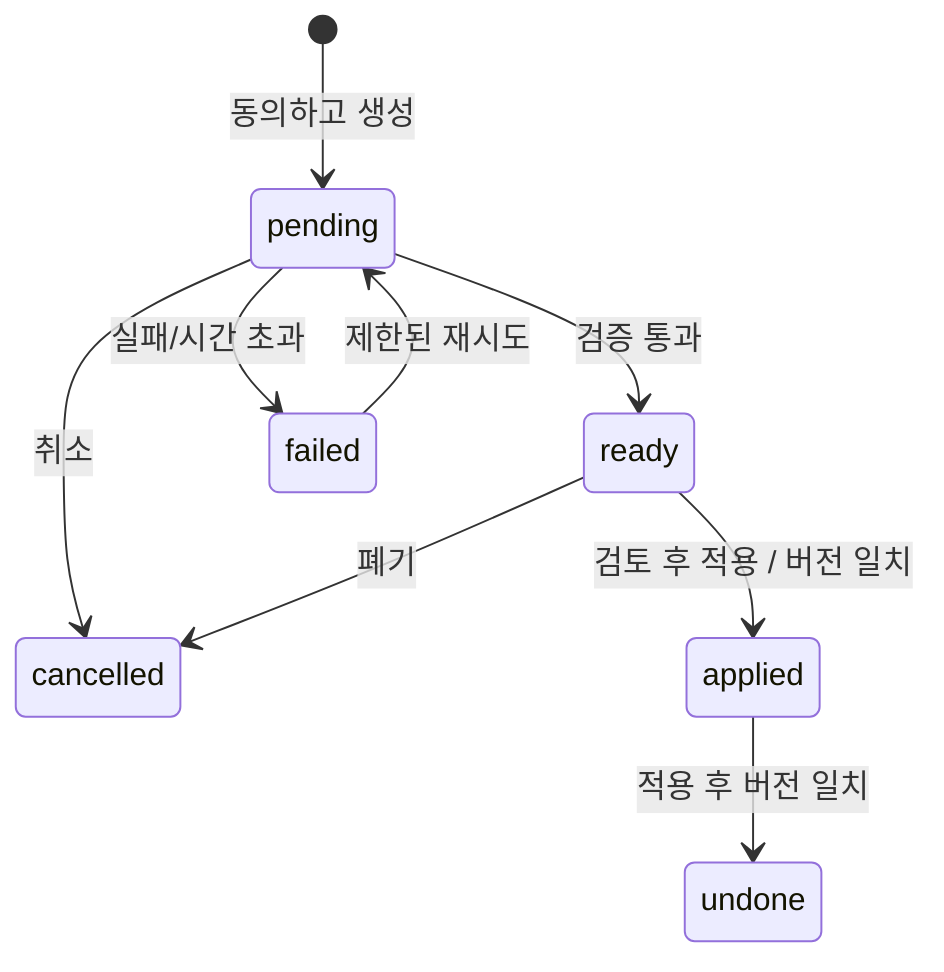

# MCP 연결과 사진 AI 정리

시작 기준은 `57d76636310ce9aaa449296a6772015da384c932`. 기존 작업 공간 변경은 보존하고 별도 clone의 `feat/mcp-photo-ai`에서 작업한다.

## 기준 배포 근거

- GitHub 최신 성공 Deploy [38064584474](https://github.com/Junjak-Personal/pic-blog/actions/runs/38064584474), 위 SHA, 2026-10-10 15:43:56 UTC 완료.
- 운영 `/api/version` 응답 `mv2kcq0t`.
- 읽기 전용 SSH 확인: 운영 컨테이너 생성 `2026-10-10T15:43:45.356332758Z`, 이미지 `sha256:e5f7936dfc36eb91f148070826aa35aefe3a4e1229bb6d442a80d1a35d9250d3`. 해당 배포의 컨테이너 교체 로그 시각과 일치한다. 이미지 commit 라벨은 없으므로 SHA 직접 증명은 불가능하고 배포 기록과 생성 시각을 함께 근거로 삼는다.
- 기존 로컬 10월 17일 MCP 계획은 미추적 문서만 있으며 코드 구현은 없다. 원본 문서·작업 공간은 변경하지 않는다. Memo OAuth/CIMD 구현 기법을 가져오되 현재 의존성만 사용한다.

## 범위와 검증

MCP: 단일 편집자 소유 모델, CIMD/PKCE 승인, 회전·철회, 4개 도구(list_posts/read_post/update_post/update_point), 공유 입력 검증, 충돌 보호. 사진 업로드·삭제·공개 전환 도구 없음.

AI: 편집자 요청으로만 생성. 사진·위치·시각·추가 맥락의 전송 범위를 알린다. 사진 썸네일은 선택. 기존 그룹 기본 보호, 작성한 텍스트/태그/링크/금액은 서버에서도 보호. 40장 상한, 45초 timeout, 중복 방지, 최대 2시도, 일일 상한, 토큰 사용량. 완전한 사진 분할 검증, 검토 후 원자 적용, 충돌 감지와 되돌리기.

검증: 기존 알고리즘+신규 권한/검증/트랜잭션/공급자 mock 테스트, Nuxt typecheck/build, 격리 synthetic SQLite와 로컬 UI smoke. 운영 데이터·실사진 전송 없음.

## 설정 경계

NiVoca Cloud에서 설정 식별자만 확인: `ANTHROPIC_API_KEY`, NiVoca BE 직접 호출이며 공용 사진 프록시 없음. 키 복사/설정·실 API 호출·OAuth 실제 연결·push·PR·배포는 하지 않는다. 실제 API 활성화는 `NUXT_AI_API_KEY`, MCP 활성화는 `NUXT_SITE_URL`의 배포 환경 설정이 필요하다. 값은 채팅·문서·저장소에 넣지 않는다.

## 검증 근거

판정: **VERIFY_PASS — 로컬 구현/모의 공급자 범위**. 실제 서비스 활성화는 아래 별도 항목이다.

- Node 24.22.1. 원본과 동일 lockfile의 설치된 의존성을 별도 작업 공간에 복사했다. `pnpm`은 고정된 `@pnpm/exe@11.28.0` 다운로드에서 “No matching version” 오류여서 패키지 스크립트가 가리키는 기존 실행 파일을 직접 실행했다. package/lockfile은 변경하지 않았다. 새 환경의 clean install은 미검증이다.
- `node node_modules/nuxt/bin/nuxt.mjs typecheck`: exit 0.
- `node node_modules/vitest/vitest.mjs run`: **7 파일, 82 테스트 통과**, exit 0. 신규 MCP/OAuth 32, 사진 AI 25, 기존 shared 25.
- `node node_modules/nuxt/bin/nuxt.mjs build`: exit 0. 기존 `tokens.css`의 상대 색상 calc 파서 경고 및 큰 청크 경고는 남는다. 해당 CSS/기존 지도 의존성 변경 없음. 린터 스크립트는 없다.
- `node node_modules/@playwright/test/cli.js test -c _workspace/e2e/mcp-ai/playwright.config.ts`: **13 테스트 통과**, exit 0. 기존 10개 + 신규 통합 smoke 3개. 실행용 config는 기존 테스트의 고정 SQLite 경로를 유지하면서 pnpm wrapper만 직접 Node 실행으로 대체했다.
- 신규 UI: 전송 동의·썸네일 기본 OFF·그룹 선택·미설정 키 오류·합성 제안 검토·적용/되돌리기 표시·390px 화면 가로 넘침 없음. 공급자 결과 UI는 mock, 서버 적용/되돌리기는 실제 SQLite 단위 테스트에서 검사했다.
- 신규 HTTP: 무인증 401, 위조 출처 거부, 발견 문서/발급자 위조 방지, 로컬 가짜 CIMD→편집자 승인→PKCE 교환→MCP 비공개 읽기·포인트 수정→**SQLite에서 저장값 확인**→낡은 버전 거부→갱신 토큰 재사용 시 접근 차단. 승인 페이지 프레임 차단 헤더 확인.
- AI 테스트: 사진 분할/소속 검증, 수동 내용·미확인 좌표 보호, 같은 시각 편집 충돌, 원자적 apply/undo, 중복/취소/재시작/지연 응답, 최대 재시도·일일 한도(기록 삭제에도 유지), 제한 전송 및 썸네일 경로/심볼릭링크/크기.
- 별도 보안 리뷰에서 늦은 응답의 재시도 덮어쓰기, quota 장부 삭제, chunked 본문 제한, NaN 한도, 승인 페이지 프레임 보호를 보완. 현재 열린 고위험 발견사항 없음. 단일 Node 프로세스 전제.
- `git diff --check`: 통과. 원본 저장소 상태는 시작 때와 동일한 기존 문서 변경 2건만 존재한다.

근거 파일(이 작업 공간의 gitignored 임시 산출물): `_workspace/e2e/mcp-ai/{unit.log,build.log,e2e.log,flows.spec.ts,playwright.config.ts,photo-ai-mobile.png,mcp-desktop.png,oauth-consent-mobile.png}`. 실제 운영 키·사진·승인 토큰을 담지 않는다. 합성 테스트 OAuth 파일은 종료 후 폐기했다.

## 구현의 한계와 운영 활성화 대기

- 실제 Claude 호출 **0회**, 실제 사진·위치 전송 **0회**. NiVoca 키 원문을 읽거나 복사/설정하지 않았다. 비용·계정 접근 가능성은 미검증이다.
- 필요한 설정은 Picblog 실행 환경의 `NUXT_AI_API_KEY`, MCP용 `NUXT_SITE_URL=https://pic-blog.jun-devlog.win`. Actions YAML에는 이 이름의 secret/variable 참조만 준비했으며 원격 값은 만들지 않았다. 기본 모델은 [공식 모델 목록](https://platform.claude.com/docs/en/models/overview)에 맞춘 `claude-sonnet-5-5`다.
- 실제 MCP grant 생성/설정, 사용자 클라이언트 등록·연결, 키의 새 앱 접근 설정은 별도 사용자 승인이 필요하다. 현재 상태는 **미실행·승인 대기**, 거절 또는 불확실한 원격 실행 없음.
- push/PR/병합/배포/원격 리소스 생성 없음. `main` push가 운영 자동배포라는 기존 규칙 유지.
- 새 의존성 금지에 따라 공식 SDK 대신 기존 Nitro/Node로 stateless JSON 전송을 구현했다. [MCP 전송 명세](https://modelcontextprotocol.io/specification/2025-06-18/basic/transports)를 기준으로 지원하며 실제 Claude/ChatGPT 호환성 확인은 남는다.
- 기록당 최대 40장, 같은 제안 최대 2회 시도, 하루 최대 20회(UTC), 45초 시간 제한. 네트워크 실패/취소 후 공급자가 사용량을 주지 않으면 토큰 수는 미확인이고 시도 횟수는 항상 차감한다.
- 수동 기록이 있는 포인트는 항상 보호하며, 기본 보호를 해제한 빈 포인트만 재배치·제목 생성한다. AI 생성 후 제목도 다음 요청에서는 보호 대상이다.
- 기존 웹 PATCH는 이전처럼 선택적 버전을 보내지 않는다. AI는 변경 뒤 apply/undo를 거절하지만, 다른 탭의 오래된 웹 초안 저장 자체를 막는 변경은 하지 않았다.
- undo는 적용 직후의 내용과 같을 때만 가능하다. 다른 기록이 원래 포인트 번호를 재사용했다면 충돌로 거절한다. 자동 복구로 다른 기록을 덮지 않는다.
- OAuth 저장은 단일 프로세스 전제. AI 요청 스냅샷 보관 만료는 현재 없다.

## Deferred QA

- ID: 2026-11-02-mcp-photo-ai-plan-01
  - Priority: P1
  - Preconditions: 사용자가 승인한 Picblog 전용/임시 키가 서버 비밀 설정에 등록됨
  - Actions: 비민감 합성 사진 2~4장으로 Claude 실제 요청 1회, 미리보기→적용→새로고침→되돌리기 확인
  - Expected: 실제 토큰 사용량과 결과가 저장되고 모든 사진이 정확히 1회 포함되며 수동 기록 유지
  - Source: 사진 AI 인수 조건
  - Status: pending
  - Evidence: —
- ID: 2026-11-02-mcp-photo-ai-plan-02
  - Priority: P1
  - Preconditions: 별도 배포 승인과 NUXT_SITE_URL 설정, 사용자가 실제 연결을 직접 시작
  - Actions: Claude 웹/폰·Claude Code·ChatGPT에서 연결/읽기/글 수정/연결 해제 확인
  - Expected: 클라이언트별 OAuth 성공, 삭제·공개 전환 도구 없음, 해제 후 접근 거부
  - Source: 중단된 10월 17일 MCP 계획
  - Status: pending
  - Evidence: —
- ID: 2026-11-02-mcp-photo-ai-plan-03
  - Priority: P2
  - Preconditions: 새 환경에서 고정 pnpm 버전 설치 가능
  - Actions: frozen-lockfile clean install 후 typecheck/test/build
  - Expected: 기존 의존성 복사 없이 동일 검증 통과
  - Source: 이번 실행 환경의 pnpm wrapper 제약
  - Status: pending
  - Evidence: —

## Clean install 후속 조사

판정: **BLOCKED — 새 네트워크 권한 없이 설치 실행 불가**. 구현 코드·package.json·pnpm-lock.yaml·pnpm-workspace.yaml·전역 도구 설정은 변경하지 않았다.

확인된 원인과 경계:

1. PATH의 `/Users/jun/.local/share/mise/installs/pnpm/latest/pnpm`은 실제로 **11.22.0 standalone 실행 파일**이다(프로젝트 밖 `/tmp`에서 `--version`으로 확인). 프로젝트의 pin **11.28.0**과 달라 자동 버전 전환 단계로 진입한다.
2. 이전 오류는 프로젝트 의존성 해석 전 **`@pnpm/exe@11.28.0` 부트스트랩**에서 발생했다. 로컬 `v11/metadata/registry.npmjs.org/@pnpm/exe.jsonl`에는 11.28.0이 없고 11.x 목록은 11.24.0까지다. 반면 일반 `pnpm` 패키지 캐시 메타데이터에는 11.28.0이 있다. 따라서 일반 pnpm 버전 자체가 존재하지 않는다고 해석하면 안 된다. 캐시만으로 현재 registry의 @pnpm/exe 게시 상태를 단정하지 않는다.
3. [공식 v11.28.0 릴리스](https://github.com/pnpm/pnpm/releases/tag/v11.28.0)는 존재한다. 정상적인 복구 경로는 공식 일반 `pnpm@11.28.0` 패키지 또는 해당 공식 릴리스 실행 파일을 격리 디렉터리에 받아 같은 버전으로 실행하는 것이다. 버전 변경이 필요하다는 근거는 없다.
4. 이번 실행 환경에서 `curl -I --connect-timeout 5 --max-time 10 https://registry.npmjs.org/pnpm/11.28.0`은 **exit 6: Could not resolve host: registry.npmjs.org**. 현재 권한의 shell 네트워크로는 공식 registry 메타데이터/패키지 다운로드를 확인할 수 없다. 새 네트워크 권한을 요청하거나 우회 경로로 파일을 가져오지 않았다.
5. mise 설치 목록과 `~/Library/pnpm/.tools`에 11.28.0 실행 파일이 없고, pnpm store의 해당 패키지 이름 및 npm cache의 `pnpm-11.28.0.tgz` 인덱스도 발견되지 않았다. 메타데이터만으로 오프라인 clean install을 실행할 수 없다.
6. [pnpm 11 설정 변경](https://pnpm.io/blog/releases/11.0)에 따라 옛 `managePackageManagerVersions` 대신 `pmOnFail`을 쓴다. 이전의 `--manage-package-manager-versions=false` 시도는 유효한 해결 근거가 아니다. 이번에는 `ignore` 등으로 11.22.0을 강제 사용하지 않았다.

상태: 공식 registry 다운로드 **차단**, clean install 및 그 설치본의 typecheck/test/build **미실행**. 자동 승인 리뷰 거절은 없고, 결과가 불확실한 설치도 없다. 후속 지시의 「새 권한이 필요하면 실행하지 말라」에 따라 여기서 중단했다. 기존 82개 단위·13개 브라우저·타입·빌드 검증 결과는 유지된다.

다음 실행 조건: 이 작업 공간에서 공식 registry(및 잠금파일이 지정한 공식 다운로드 호스트)에 접근할 수 있는 실행 권한이 제공되면, 전역 도구를 바꾸지 않고 격리된 tool 디렉터리에 정확히 pnpm 11.28.0을 설치한다. 소스 복사본에 `node_modules` 없이 `install --frozen-lockfile`을 실행하고 typecheck/test/build를 진행한다. 검증 전후 아래 SHA-256이 같아야 한다.

- package.json: `283c8e54f49a31213b6b710204af4fd7baf2102192ff6e76b85ea3da399d2662`
- pnpm-lock.yaml: `23fd20d261f92ed0814e4703fbe21080e832160ce1e71ddb537a0521163e281a`
- pnpm-workspace.yaml: `2759e1d7664222c94b9f098b56fd5ab6069f7be5d8a051ca5ab5ffd526baecb9`
