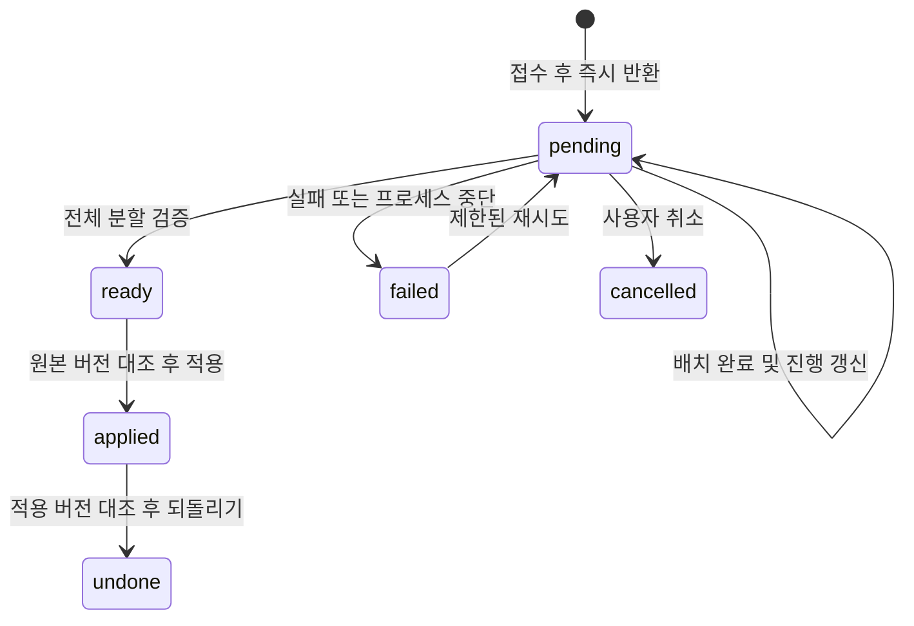

# 사진 AI 1,000장 처리와 운영 일괄 정리

기준 SHA `96714fea1280555e6de47157443af11400ef4540`. 사용자가 운영 사진 재그룹핑·타이틀 생성을 요청했고, 이어 기존 40장 제한을 1,000장으로 늘리도록 지시했다.

## 범위

- 선택한 편집 가능 사진 기준 1~1,000장. 보호 사진은 상한에서 제외한다.
- 공급자 요청은 최대 40장씩 나누고, 비동기 작업 접수·진행 조회·취소·재시도를 제공한다. 모든 결과의 사진 누락·중복 검증 후 기존 apply/undo를 사용한다.
- 수동 내용·잘못된 GPS·명시 보호 포인트, 원본 파일·사진 좌표·촬영 시각, 동시 편집 충돌 보호를 유지한다.
- UI는 선택 수·상한·진행률·완료/실패를 보여 준다. 새 의존성 없음.
- 운영 요청은 북큐슈(기록3), 다카야마·카미코치(기록2), 타카마쓰 1일차(2026-09-30,80장)를 제외한 7기록 2,512장이다. 이 작업은 별도 백업·결과 장부를 갖는 일회성 실행이다. 전체 생성·검토·복사 DB 리허설 후 운영에 원자 적용한다.

## 소유와 검증

- 서버·공유 타입: backend 담당. 화면: UI 담당. 문서·통합 검증·운영 실행: root.
- 단위: 1,000장/1,001장, 보호된 대형 기록, 배치 경계 ID, 누락·중복, 취소/지연 응답, 재시도·작업 접수, 사용량.
- 통합: typecheck·전체 Vitest·빌드, 비동기 화면 기존 스모크. 운영은 전체 원본/제외 데이터·사진 메타데이터·무결성 대조 및 공개 UI 확인.
- 작업 중 원본 checkout의 `_docs/index.md`, `_docs/active/planning/`는 보존한다.

## 실행 상태

- 운영 백업: `/home/junja/apps/pic-blog/data/bulk-ai/20261103-regroup/before.db` (0600).
- 최초 점검: 9기록·428포인트·3,135사진, 대상2,512사진, 보호10포인트 및 제외2기록.
- 일괄 생성 84묶음·2,512장 완료. 공급자 요청 93회, 확인된 입력 662,382 / 출력 111,882 토큰. 프로세스 중단 당시 진행 중이던 2요청의 사용량은 미확인이다. 완료된 결과를 재사용해 재개했다.
- 출력의 원본 포인트 소유권 검증 후 새 포인트 번호를 배정하고, 사진 exact partition·제목·설명을 검증했다. 별도 안전 검토에서 사진 손상/제외영역 변경 경로를 찾지 못했다.
- 복사 DB에서 적용 및 역변환 후 9개 기록의 전체 행이 원본과 정확히 일치했다. `rehearsal.json`에 `rollbackExact: true`를 기록했다.
- 운영 트랜잭션 적용 완료. 전체 9기록·670포인트·3,135사진. 새 AI 그룹568개, 기존 보호102포인트 유지. 사진 원본 필드·제외 기록2개 전체·타카마쓰1일차10포인트/80사진 전체 행 보존. `foreign_key_check`와 `quick_check` 통과.
- 기록별 포인트 수: 도쿄근교66→88, 경주27→34, 시즈오카58→91, 기후/나고야36→58, 도쿄-쿠사츠53→83, 대만23→43, 타카마쓰73→181(보호10 포함).
- `before.db`, `pre-apply.db`, `after.db`를 0600으로 보관했다. `plan.json`, `usage.json`, 배치별 결과, `review.json`, `rehearsal.json`, `applied.json`, 실행 코드 `runner/`는 같은 운영 작업 디렉터리에 보관한다. 키는 실행 환경에서만 읽고 저장하지 않는다.

## 구현과 검증 — VERIFY_PASS

- 보호 후 선택한 사진 상한1,000장, 실제 썸네일 크기 기반 최대40장/8MB 배치, 날짜/포인트 경계 우선.
- 비동기 pending 즉시 반환, 2초 UI polling, DB checkpoint/진행 표시, 취소·재시도 및 완료 배치 재사용. 내부 배치는 일일 사용자 요청 한도를 따로 소비하지 않는다.
- 10초 heartbeat·배치별45초 제한. 전용 검토에서 발견한 heartbeat SQLite 예외의 프로세스 전파를 수정하고 SQLITE_BUSY 회귀를 추가했다.
- 타입 검사 통과. Vitest 7파일90테스트 통과. 최종 빌드 통과. 새 의존성 없음.
- 실제 Claude+ego-browser 합성41장: 2배치 완료, ready 새로고침 복구→apply 새로고침→undo 새로고침. SQLite 포인트·사진 전체 행 원복 확인. 입력19,949/출력1,006토큰. 이 검증은 운영 사진과 분리한 로컬 환경이다.
- 1,000장/1,001장·보호 포함 대형 기록·취소/늦은 응답·checkpoint 재시도·65초 초과 heartbeat·DB 실패는 단위검증으로 확인했다. 실제1,000장 단일 UI 작업은 미실행이다.
- 배치 경계를 넘는 그룹 재통합은 하지 않는다. 프로세스 재시작 시 중단된 pending은 stale 처리 후 사용자 재시도로 복구한다.

## Deferred QA

- ID: 2026-11-03-photo-ai-1000-plan-01
  - Priority: P2
  - Preconditions: 실제 1,000장 편집 가능 기록과 분석 동의
  - Actions: 웹에서1,000장 분석 중 새로고침·실패 재시도, 미리보기·적용·되돌리기
  - Expected: 진행 복구, 모든 사진1회 포함, 완료배치 재사용, 사진 원본/보호 데이터 보존
  - Source: 선택1,000장 인수조건의 실제 최대크기 UI 경계
  - Status: pending
  - Evidence: 1,000장 단위검증과 실제41장 UI 검증은 통과; 실제 최대크기 UI 미실행

