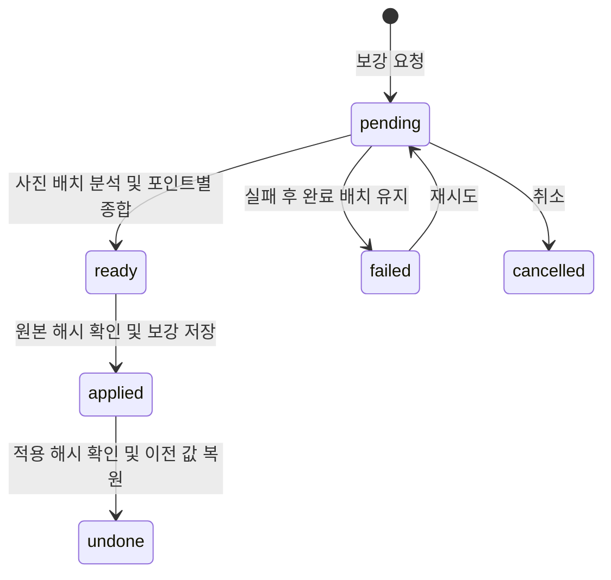

# 사진 대표 선택과 여행 기록 보강

기준 dc71216683a886dec8856d84b4fa35b3d38589b3. 사용자가 대표 사진 선택 → 짧은 설명 → 장소명 보강 진행과 API 중심 테스트를 승인했다.

## 범위와 계약

- 기존 사진 AI 화면과 async 제안/적용/되돌리기에 선택적 enrich 모드를 추가한다. 기존 organize 요청은 하위 호환 유지.
- 사진을 실제 분석해 포인트 대표 사진과 1~3문장 사실 설명을 제안한다. 감정·맛·방문 목적·신원은 추측하지 않는다.
- 사진에 직접 읽히는 장소명은 근거 사진과 함께 후보로 제시한다. GPS만으로 이름을 확정하지 않고 기존 제목을 자동 덮어쓰지 않는다.
- 현재 포인트 ID·사진 소속/순서·앵커·촬영 시각 유지. 기존 본문/태그/링크/비용 및 명시 제외 포인트 보호. 제목만 있는 포인트는 보강 가능.
- 선택 최대1,000장, 요청당40장/8MB 배치. 한 포인트가 배치를 넘으면 결과를 종합해 최종 포인트1개 유지.
- 제외 범위: 북큐슈 전체, 다카야마/가미코치 전체, 타카마쓰2026-09-30 전체.
- backend 담당 server/ai 및 shared/types/photo-ai.ts; UI 담당 기존 organize 페이지; root 통합/API검증/운영 및 문서. 새 의존성 없음.

## 검증

- 단위: 기존 organize 회귀, cover 소유권/사진 완전성, 다중 배치 종합, 수동 기록 보호, 제목 유지, 적용/되돌리기, 충돌 및 재시도.
- 실제 API: 인증/Origin 거절, Claude 이미지 분석, 비동기 상태·중복 요청, 미리보기 무변경, 적용 후 조회/DB지속성, 되돌리기.
- typecheck / test / build. 사용자 지시대로 브라우저 E2E 대신 API로 검증하며 화면 조작 검증은 별도 상태로 남긴다.

## 구현 및 검증 — VERIFY_PASS

- 선택적 enrich 모드, 기존 mode 생략/organize 호환. 자동 보호와 전체 사진/포인트 소유권 검증. 원래 제목 및 유효한 사용자 지정 여행 커버 보존.
- 전 사진 배치 분석 후 같은 포인트의 배치 설명과 최대15개 대표 후보를 종합. 추가 이미지 최대7.68MB. 분석/종합 체크포인트 분리, 취소·재시도·해시 충돌 검사 유지.
- 본문은 서버에서300자·1~3문장 검사, 모델에는220자·1~2문장 목표. 사진 속 공공 간판 이름만 근거 사진을 동반한 후보로 제시하며 제목 자동 변경 없음.
- UI에서 대표 사진/본문/장소 후보 검토, 적용/되돌리기. API로 생성한 제안은 `?proposal=<UUID>` 링크로 열 수 있다.
- 최종 통합: Vitest7파일107테스트 통과, pnpm typecheck 및 pnpm build 통과. 독립 보안/데이터정합성 검토에서 차단 결함 없음.
- 실제 운영 사진의 복사본54장, Claude API3묶음(분석2+종합1) 완료. 첫 시도 형식 검증 실패 후 재시도 정상 완료. 확인된 입력28,925/출력1,629토큰, 작업2시도. 최초 응답 원문은 확보하지 않아 형식 실패의 세부 원인은 미확인이다.
- HTTP API 인증/Origin/이미지 비동의 거절, 중복 요청 같은 작업 반환, 미리보기 원본 무변경, 적용 후 상세조회와DB저장, undo 포인트/사진 원복 확인. 전체 사진 행·선택외 포인트·제목·좌표·시각·순서 보존. 인증된 편집 페이지 HTTP서버렌더링도200 확인.
- 운영 적용 전 백업 `/home/junja/apps/pic-blog/data/bulk-ai/20261103-enrichment/before.db`, 이전 이미지 `pic-blog:before-enrichment-20261103`.

## Deferred QA

- ID: 2026-11-03-photo-enrichment-plan-01
  - Priority: P2
  - Preconditions: 운영 편집 로그인과 보강 제안
  - Actions: 모바일/데스크탑에서 모드 전환, 결과 미리보기, 적용/되돌리기 버튼 및 새로고침
  - Expected: 제안 모드·사진·설명·후보가 맞고 진행/저장 상태가 유지됨
  - Source: 클라이언트 이벤트/반응형 화면 경계
  - Status: pending
  - Evidence: 사용자 요청에 따라 HTTP API 및 서버렌더링으로 검증. 실제 브라우저 조작은 미실행.
